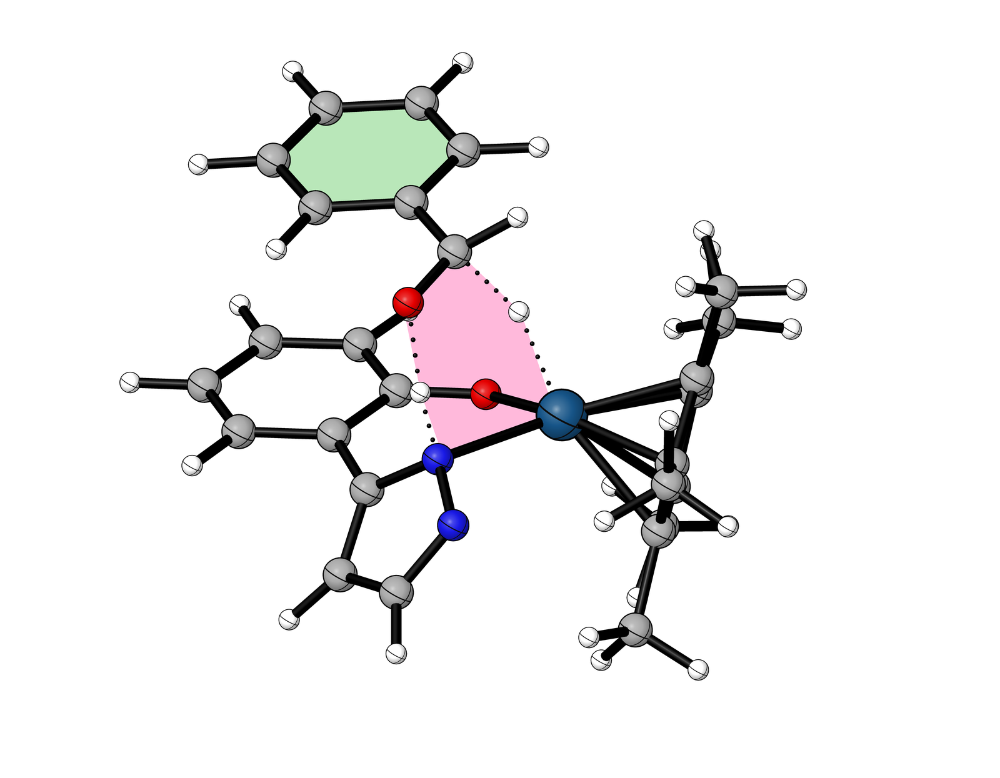
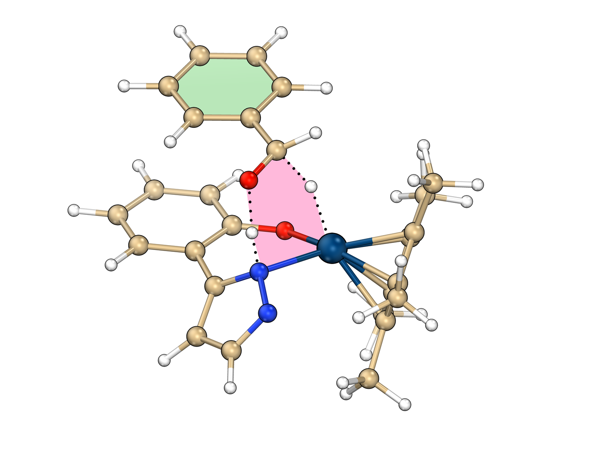
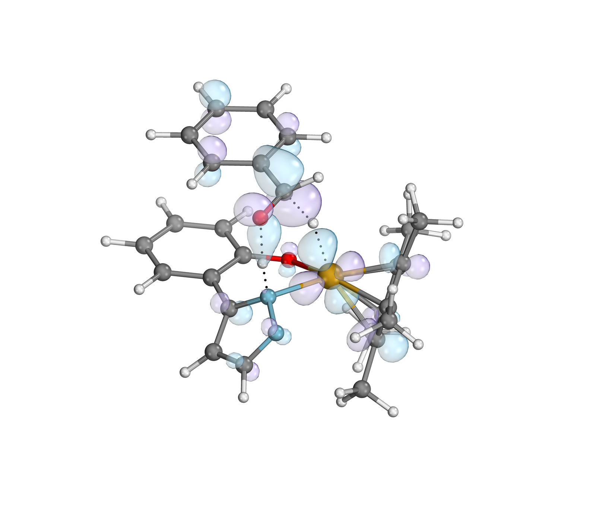
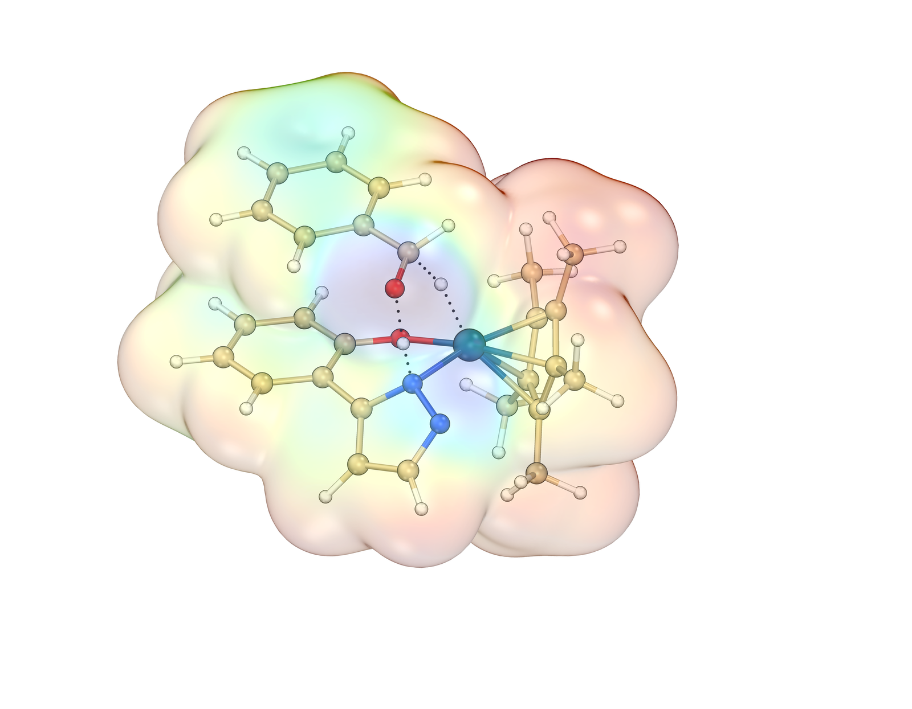
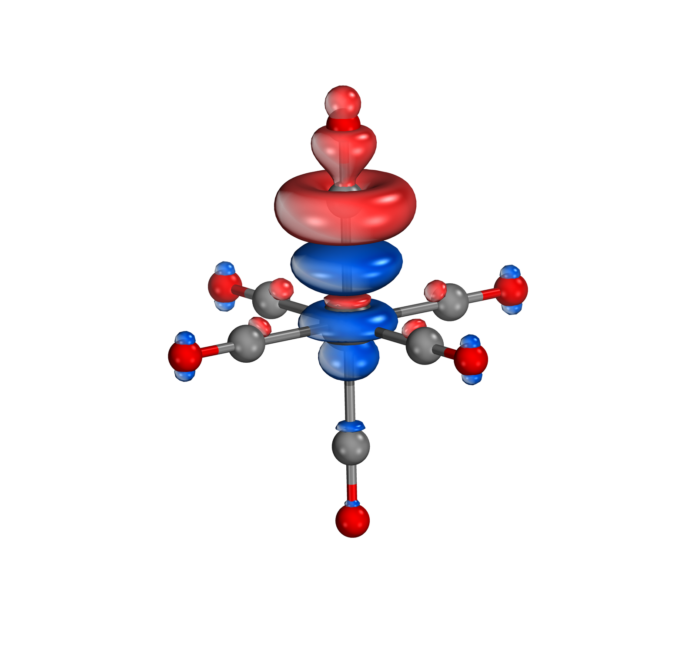
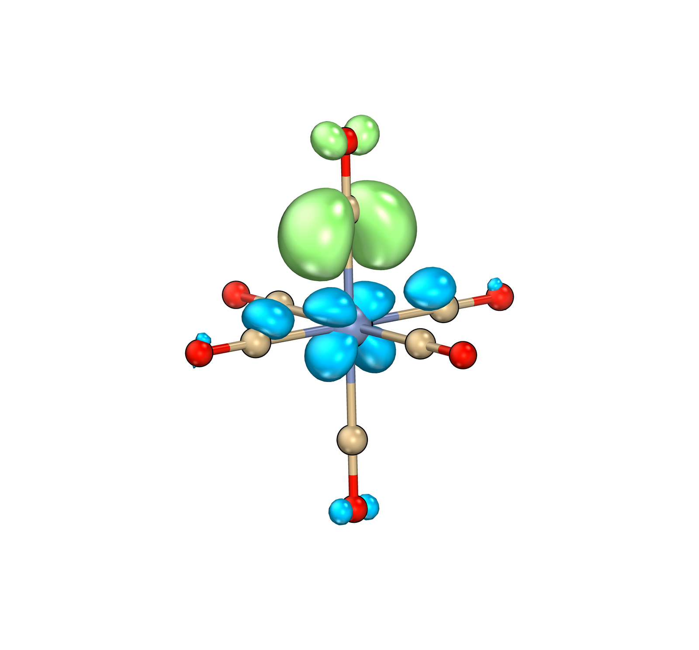
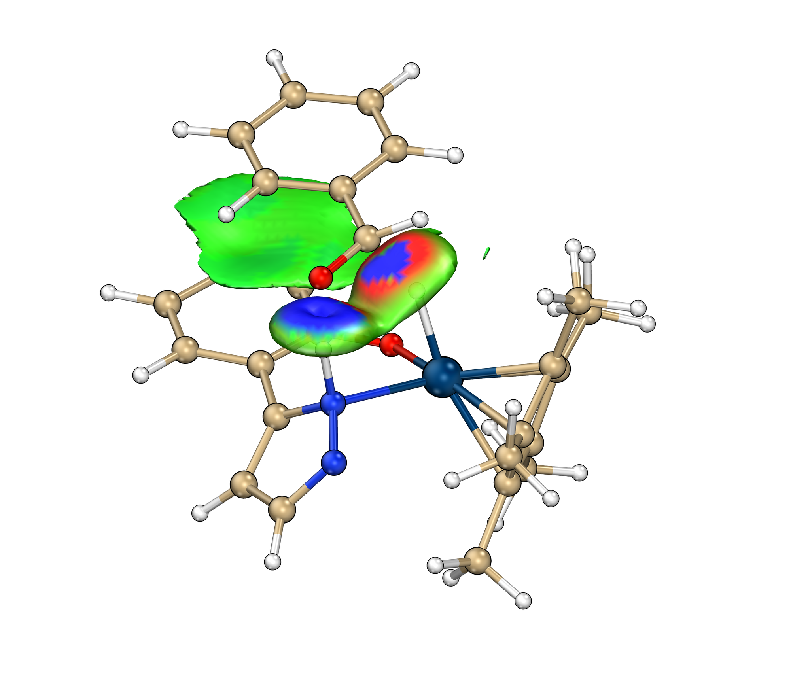
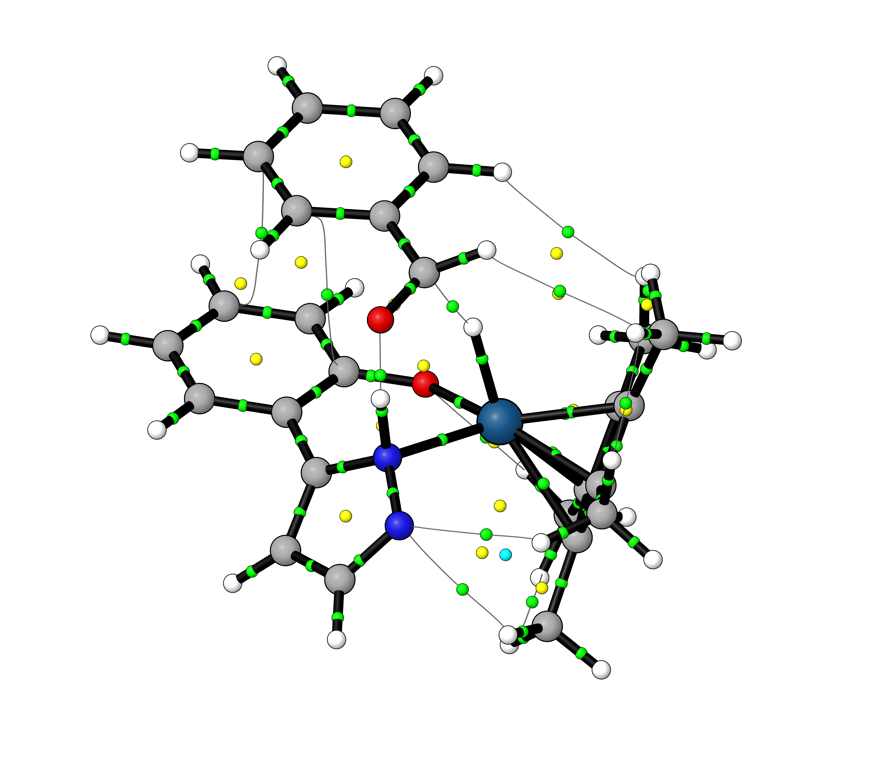
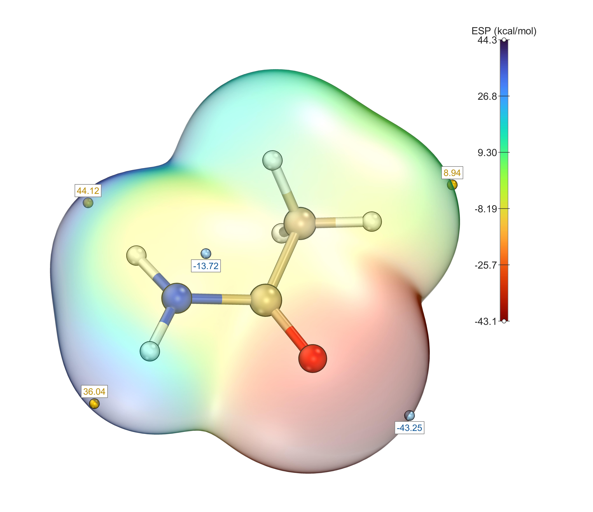

<h1 align="center">GXNU MolStudio</h1>

<p align="center">
  
  
  
  <a href="https://doi.org/10.5281/zenodo.22821586"></a>
  <a href="https://doi.org/10.26434/chemrxiv.15009253/v2"></a>
</p>

<p align="center">
  <strong>English</strong> · <a href="./README_zh.md">简体中文</a>
</p>

<p align="center">
  <b>An integrated visualization and workflow platform for computational chemistry — from fchk to publication-ready orbital images in one go.</b>
  <br>
  <sub>Hou Cheng Research Group · Guangxi Normal University</sub>
</p>

---

## Gallery

Publication-style renders — molecular views and wavefunction-analysis figures.

<p align="center">
  
  
  
</p>
<p align="center">
  
  
  
</p>

<p align="center">
  <b>Analysis results — IGMH · AIM · ESP</b>
</p>
<p align="center">
  
  
  
</p>

---

## About

GXNU MolStudio is an **integrated visualization and workflow platform** for computational chemistry. It ships an embedded OpenGL 3.3 real-time rendering engine and pulls a workflow that used to be scattered across several programs — generate a cube, preview it live, export a figure, process a folder in batch — into a single GUI.

One point about its scope: **the program itself does not perform wavefunction analysis.** Orbital surfaces, charge populations, Mayer bond orders, ESP, IGMH/IRI weak interactions, AIM topology, molecular planarity (MPP) and ETS-NOCV are all computed by [Multiwfn](http://sobereva.com/multiwfn/) (by Prof. Tian Lu). MolStudio drives it, parses its output, and turns the numbers into interactive isosurfaces, curves and charts. Modules such as the DI energy decomposition, the Energetic Span Model and IRC splitting work the same way: the program reads Gaussian / Multiwfn output and does the post-processing and plotting itself.

What is integrated today: **reading** Gaussian / Multiwfn inputs and outputs (fchk, cube, wfn/wfx, log/out, chg, cif, xyz …), **driving** Multiwfn for cube generation and wavefunction analyses, and **doing** the real-time visualization, figure export and batch processing. The spectra page can also generate and run local Gaussian spectrum jobs directly from a structure before calling Multiwfn to broaden and plot the result. Generic remote job submission, queueing and cluster monitoring remain outside this release.

| Step | Computed by | MolStudio's role |
|---|---|---|
| Wavefunction analysis: charges / Mayer bond orders / ESP / IGMH·IRI / AIM / MPP / ETS-NOCV | Multiwfn | invoke, parse, visualize |
| Orbital cube generation | Multiwfn | trigger, progress & log, batch mode |
| UV-Vis / ECD / IR / Raman / VCD / ROA / fluorescence / phosphorescence | Gaussian + Multiwfn | structure import, job generation and local run, broadening, plotting |
| Live 3D preview and one-click rendering | this program (embedded OpenGL engine) | everything |
| Offline high-resolution rendering (compatibility channel) | VMD + Tachyon | style setup and invocation |
| Post-processing & plots (DI / ESM / IRC …) | this program | everything |

> So whenever you export a figure or obtain quantitative results with MolStudio, please also cite Multiwfn. The **Citations** tab on the right of the GUI lists the references required by whichever function you have open.

| Task | Traditional workflow | GXNU MolStudio |
|---|---|---|
| cube generation | type commands by hand | double-click an orbital, auto-generated |
| 3D preview | manually load & tweak isovalues | embedded OpenGL canvas with live sliders |
| rendering | tune lights & materials by hand | one-click styles, instant images |
| weak interactions | run IGMH/IRI separately, then compose | one-click run (Multiwfn) and visualization in-panel |
| batch processing | repeat file-by-file | drag in a folder, fully automated |

---

## Features

> Quantitative results in the modules below are computed by **Multiwfn** (or read from Gaussian output); MolStudio invokes them, parses the results and visualizes them.

### 🧬 Embedded OpenGL rendering engine (ovcanvas)
- **Order-independent transparency compositing (depth peeling)** — correct in-plane transparency sorting across layers; automatic fallback to sorted blending when unavailable
- **One-click styles** — sob-art / IBOview / HoukMol / HoukMol3d / **2D flat** / IQmol / MolStudio / CYLview / VESTA default looks, switchable in one click (2D flat = HoukMol palette with unshaded, flat spheres)
- **Atom colors × lights, two orthogonal axes** — atom palettes (CPK / SobArt / HoukMol / Vcube …) × lighting rigs (3-light / 1-light / 2-light / 4-light) in any combination
- **Per-light glow** — light dialog for direction / count / glow with fine tuning, save & load
- **Ring rings** — HoukMol-style equatorial great circles; azimuth / elevation adjustable, lockable

### 🔬 Molecule display helpers
- **Hide hydrogens** — hide all H atoms with one click to highlight the heavy-atom skeleton
- **Keep selected H** — enter indices (e.g. `1,3,5-8`) to show only chosen hydrogens
- **Atom indices / element symbols** — label each atom with its in-molecule number or element symbol
- **School molecule library** — 69 built-in junior- and senior-high-school molecules
  with category, name, formula and alias search; double-click to visualize
- **PowerPoint 3D models** — export the current molecule and every visible
  molecular-orbital, electrostatic-potential or other isosurface as one
  self-contained `.glb` for PowerPoint 365 (`Insert → 3D Models → This Device`).
  Phase/ESP vertex colours, transparency, atom palette, bonds, hidden atoms,
  ball-and-stick scale and the current view are preserved, with dense
  vertex-colour meshes, double-sided PBR, thin black outlines and KDTree-baked
  contact AO. ESP scenes also write a matching `_legend.png` colour bar.

### 🧪 IGMH / IRI weak-interaction analysis
- **One-click analysis** — pick fragments, run IGMH or IRI indices through Multiwfn
- **BGR coloring** — sign(λ₂)ρ blue-green-red coloring; isosurface size / opacity sliders plus precise input boxes
- **IGM scatter plots** — embedded scatter-plot viewer

### ⚡ Quantum-chemistry data analysis
- **One-click molecular spectra** — import `.xyz` / `.gjf` / `.log` / `.fchk` or use
  the current canvas structure, choose UV-Vis, ECD, IR, Raman, VCD, ROA,
  fluorescence or phosphorescence, and run Gaussian → Multiwfn → plot as one
  workflow. Electronic spectra can pre-optimise the ground state, vibrational
  jobs receive the matching `freq` route, and ROA supports multiple incident
  wavelengths. Fluorescence optimises S1 and keeps only its emission strength;
  phosphorescence optimises T1, stabilises the S0 reference and computes the
  triplet vertical-emission energy. Existing `.log/.out` files can be re-plotted
  without recomputing. Plain Gaussian TDDFT has no spin–orbit coupling, so the
  phosphorescence band position is meaningful while its intensity is explicitly
  normalised.
- **Orbital browser** — orbital energies, occupations, HOMO/LUMO labels; double-click to generate a cube
- **Orbital localization (LMO)** — drives Multiwfn main function 19 to localize the
  loaded `.fchk` by Pipek–Mezey (Mulliken / Löwdin / Becke) or Foster–Boys; a table lists
  each LMO with energy, occupation, single-/two-/multi-center assignment, Hirshfeld
  composition and centre, and double-clicking an LMO caches its cube on the canvas.
  Optional LMO energies (from MOs or a supplied Fock matrix), LMO centres/dipoles and
  open-shell α/β are supported; produces `<stem>_LMO.fch`, `_LMOcen.txt`, `_LMOdip.txt`
  and a full log, and can reopen the LMO wavefunction in the MO table.
- **Default UI (reference layout)** — top toolbar (open / snapshot / save image /
  measure / reset view / language / settings), grouped left sidebar, central 3D
  view, a dedicated right-hand “Properties” tab (next to Settings / Citations,
  with a load-and-refresh button and molecular/energy cards), bottom “Run log /
  Calculation output / Errors” tabs, and a status bar with version / status /
  CPU / memory. The “Tools ▾” button under the canvas expands four tool cards
  (render style, display, measure & analysis, file export)
- **Local ORCA calculation (Favorites tab)** — open “Favorites → ORCA” in the
  left sidebar; parameters sit in the right-hand settings area. It reads the
  main-window canvas / gjf structure, builds ORCA inputs (Opt / Freq /
  OptTS+Freq / IRC / TD-DFT / CPCM / SMD / D3BJ), runs locally, parses energy /
  HOMO / LUMO / frequencies, and auto-converts `.gbw → .molden.input → .fchk`
  (Multiwfn) so existing fchk-based analysis pages can read ORCA results
- **ESP electrostatic potential** — isosurface + extrema labels + color scale bar
- **NBO analysis** — bond orders, occupations, second-order perturbation E(2) orbital pairs
- **Charge analysis** — Mulliken / fitted charges with bond-order visualization
- **IRC analysis** — track Mayer bond orders and atomic charges along an IRC path, showing each structure live in the shared canvas
- **Distortion–Interaction (DI) analysis** — the “Local workflow…” button opens
  a dedicated popup: load the transition-state log, shift-drag a box on the embedded
  structure canvas to split the complex into two fragments (click atoms to toggle
  membership, or auto-detect from bond connectivity). One click writes four
  Gaussian inputs — single points of both fragments at the TS geometry plus
  fragment optimizations, with method/basis and setup keywords copied from the
  TS log route — runs them locally with g16, then loads the five logs back on the
  DI page and plots ΔE_strain / ΔE_int / ΔE‡ (energy-step + decomposition-bar
  charts). Loading five existing logs manually is still supported; result table,
  PNG/HTML export and settings persistence are unchanged.
- **Energetic Span Model (ESM)** — catalytic-cycle analysis: identify TDI/TDTS, compute the energy span δE and TOF, step-shaped energy profiles
- **AIM topology** — QTAIM bond critical points and bond paths from `.wfn` / `.wfx` / fchk input
- **Charge & Mayer bond order** — combined charge-population and bond-order analysis
- **Steric map / buried volume (%VBur)** — orient a complex with the official
  SambVca convention (centre atom, z-axis atom, xz-plane atom, delete list), then
  compute the total / quadrant / octant %VBur plus buried and free volumes and
  plot the topographic steric map (2D + 3D surface) in one go. The map follows the
  StericRender look: **fixed ±R colour scale**, sambvca palette, black contour
  lines, molecular skeleton, quadrant labels, axis indicator and a horizontal
  colour bar, with an alternative official SambVca banded style (0.2 Å contour
  spacing, as in the official `plot_map.py`); every layer can be toggled.
  Orientation **defaults to the current canvas view** (what you see is what you
  get: rotate the molecule on the canvas and the map follows); switch to the
  SambVca official orientation for literature-comparable %VBur and press "Match
  canvas view" to rotate the canvas to the same frame. Atoms can be **picked
  directly on the left canvas** to set the centre / z-axis / xz-plane or to
  add/remove atoms in the delete list (the delete list stays in sync with the
  canvas multi-selection). The structure comes from the current canvas or from
  an imported `.xyz/.gjf/.log/.inp` file; figures export to PNG/PDF/SVG, data to
  CSV/JSON and an official SambVca `.inp`. The engine is a built-in pure-numpy
  port of the official SambVca 2.1 Fortran algorithm (%VBur 39.60 for the
  official nhc example; the map matches the official `nhc-TopSurface.dat` point
  by point), so no external SambVca program is required.
- **xTB semiempirical calculations** — runs the external **xTB** program on the
  canvas structure (or an imported `.xyz/.gjf/.com/.log/.out`) with g-xTB, GFN2,
  GFN1, GFN0 or GFN-FF: single point, geometry optimisation, optimisation +
  Hessian/frequencies/thermochemistry, numerical Hessian, TS optimisation, and
  xcontrol relaxed scans (with an energy plot). Charge/unpaired electrons, SCF
  accuracy, electronic temperature, ALPB/GBSA/COSMO implicit solvation, thread
  count and extra command-line arguments are exposed. Results include the total
  energy, HOMO–LUMO gap, HOMO/LUMO, dipole, gradient, an atomic-charge table,
  frequencies/imaginary modes and G/H/ZPE; the optimised (or last scan) structure
  can be **sent back to the canvas** in one click, and XYZ/GJF/JSON/scan
  trajectories can be exported. The xTB path is auto-detected and settings are
  saved automatically; xTB itself (LGPL-3.0) is an external program the user
  installs — MolStudio does not bundle it.
- **Electron density difference (EDD)** — use the current fchk as the parent,
  build any number of disjoint fragments by clicking or box-selecting atoms,
  and generate parent + fragment inputs with the same method/basis that
  preserve the parent coordinates and force `nosymm`. Run the parent and all
  fragment jobs plus formchk locally, or load multiple
  state/fragment wavefunctions manually. Multiwfn evaluates
  `ρ(parent) − Σρ(fragment)`, exports the cube, and MolStudio displays positive
  and negative density regions with independent colors, isovalue/opacity
  controls and VMD scene registration.
- **Orbital-weighted Fukui function (OW-Fukui)** — predicts nucleophilic and
  electrophilic attack sites for frontier-orbital (quasi-)degenerate systems
  (C60, 18-carbon ring, …) following sobereva.com/533: drives Multiwfn main
  function 22 to build the orbital-weighted f_w+ / f_w− / f_w0 and the dual
  descriptor Δf_w. The Δ parameter (default 0.1 Hartree) is adjustable; the four
  functions are shown as isosurfaces on the canvas and exported as
  `<stem>_OW_f+.cub`, `<stem>_OW_f-.cub`, `<stem>_OW_f0.cub` and
  `<stem>_OW_DD.cub`, while the
  Hirshfeld condensed OW values are tabulated (CSV export), together with the
  orbital weights of the ten most important occupied / virtual orbitals.
  Closed-shell single-determinant wavefunctions that contain virtual orbitals
  only; diffuse functions are discouraged.
- **AICD induced current** — reads the tensor dump written by Gaussian
  `nmr=csgt iop(10/93=1|2)` and renders the classic AICD figure (yellow
  anisotropy isosurface + green-shaft/red-head current-density arrows + field
  indicator). The **Scope** drop-down switches to **π only / σ only** in one
  step: Multiwfn detects the occupied π orbitals (plane method for planar
  systems, localised-orbital projection for distorted ones), the input is
  rewritten to `iop(10/93=2)` plus the orbital list (with a blank line after
  the list: without it Gaussian's AICD patch drops the last orbital), and the
  run then plots that scope. An all-electron AICD run is **not** a
  prerequisite: automatic detection only needs an fchk/chk of the same system
  (one from an opt/freq job is fine), or you can enter the indices directly
  under "Generate input… → Selected orbitals". The workflow is five buttons:
  load GJF → generate input → run locally / run on server → load results & plot. A local run renders the figure
  automatically; for a server run the panel writes the input, shows a copyable
  `g16 < job.gjf > job.log` command, and later loads the returned `.log` plus
  its tensor `.txt`. A live 3D canvas view of the isosurface plus arrows is
  included.

### 🎬 Legacy VMD / Tachyon rendering (compatibility mode)
- 30+ curated render styles (vcube2.0, in-house and custom)
- High-resolution output (BMP/PNG, 3000+), optional transparent background, shadow/AO control
- Instant Chinese/English toggle, run logs, command-line batch mode

---

## Quick Start

### Requirements

| Component | Purpose | Install |
|------|------|------|
| Python 3.8+ | runtime | [python.org](https://www.python.org/) |
| PyQt5 | GUI | `pip install PyQt5 PyOpenGL PyOpenGL-accelerate` |
| NumPy | numerics | `pip install numpy` |
| PyMCubes | isosurface extraction | `pip install PyMCubes` |
| matplotlib | scatter plots / color bars | `pip install matplotlib` |
| [Multiwfn](http://sobereva.com/multiwfn/) | fchk → cube, IGMH/IRI | download and configure the path |
| [xTB](https://github.com/grimme-lab/xtb) (optional) | semiempirical calculations (SP/OPT/frequencies/scans) | download and point the "xTB" tab to `xtb.exe` (auto-detected) |

> VMD / Tachyon are only required for the legacy render mode; the embedded OpenGL canvas does not depend on them.

### Installation

The source code lives on CNB — **[cnb.cool/chem311/GXNU-MolStudio](https://cnb.cool/chem311/GXNU-MolStudio)**, the address given in the preprint — with a mirror at [github.com/houcheng-gxnu/GXNU-MolStudio](https://github.com/houcheng-gxnu/GXNU-MolStudio).

```bash
git clone https://cnb.cool/chem311/GXNU-MolStudio.git
# mirror: git clone https://github.com/houcheng-gxnu/GXNU-MolStudio.git
cd GXNU-MolStudio
pip install -r requirements.txt      # 或：pip install -e . （以包方式安装）
```

### Configure tool paths

On first launch, browse and select the Multiwfn path (and others) in the GUI ⚙️ settings; they are saved automatically to `fchk_orbital.ini`.

### Launch

```bash
# GUI mode (English UI available; 中文内置)
python main.py
```

The GUI ships with seven interchangeable layouts — same features, different chrome.
**Classic blue theme + grouped sidebar is the default** (2026-11-12):

| `--ui` | Layout | Source |
|---|---|---|
| *(default)* / `classic_nav` | **Classic blue theme, grouped sidebar**: everything from classic (blue section badges, 设置/引文 tabs), only the flat 27-item nav is replaced by 6 collapsible groups | `main_window_classic_nav.py` |
| `classic` | pure classic three-column (flat nav, behaviour unchanged) | `main_window.py` |
| `focus` | **Focus cards (kept as an alternative)**: light-grey rounded cards, grouped sidebar, unified type scale | `main_window_focus.py` |
| `studio` | Studio full interface: grouped sidebar, single-line top bar, canvas-first | `main_window_studio.py` |
| `clean` | Clean Light cards | `main_window_clean.py` |
| `clean2` | Bridge cards | `main_window_clean2.py` |
| `canvas` | **canvas-first**: 58 px icon rail, collapsible right drawer, one-click styles in a dropdown | `main_window_canvas_first.py` |

```bash
python main.py                        # classic blue + grouped sidebar (default)
python main.py --ui classic           # pure classic
python main.py --ui focus             # grey Focus cards (still available)
python main.py --ui studio            # full interface; or MOLSTUDIO_UI=studio python main.py
```

In the default layout: `Ctrl+K` searches all tools and `Ctrl+B` collapses the
sidebar to a 56 px rail. In Focus: additionally `Ctrl+I` toggles the inspector
drawer and `Ctrl+Shift+F` switches Focus / full on the fly. See
`docs/CLASSIC_NAV_UI.md` and `docs/FOCUS_UI.md`.

### Command-line mode (batch)

```bash
# Single file, HOMO orbital, sob-art style
python main.py input.fchk --mo h --iso 0.05 --style sob-art

# Batch a folder, HOMO + LUMO
python main.py ./fchk_folder/ --mo h,l --iso 0.05

# Specific orbitals, style, high resolution
python main.py input.fchk --mo h-1,h,l,l+1 --iso 0.04 --style lakers --res 3000,2250

# cube only, no rendering (for debugging)
python main.py ./folder/ --mo h --grid 3 --no-render
```

| Argument | Type | Default | Description |
|------|------|--------|------|
| `input` | str | — | fchk file path or folder path |
| `--mo` | str | `h` | orbitals: `h` (HOMO), `l` (LUMO), `h-1`, numeric indices, comma-separated |
| `--iso` | float | `0.05` | isosurface threshold |
| `--grid` | int | `2` | grid quality: 1=low, 2=medium, 3=high |
| `--style` | str | `sob-art` | render style |
| `--res` | str | `2000,1500` | output resolution `width,height` (`widthxheight` also accepted) |
| `--no-render` | flag | — | generate cubes only, skip rendering |
| `--out` | str | same as input | output directory |

---

### Self-check

```bash
pip install pytest
pytest tests -q      # every submodule imports + offscreen UI smoke test
```

---

## Project Structure

```
GXNU-MolStudio/
├── main.py                  # Thin entry point → molstudio.app:main
├── molstudio/               # Application package
│   ├── app.py               # Startup flow (splash, UI selection, CLI batch mode)
│   ├── paths.py             # Asset / config path resolution (source & frozen)
│   ├── core/                # Backend engine: fchk_orbital, fchk_parser, marching_cubes,
│   │                        #   workers, i18n, crystal_lib
│   ├── ui/                  # Windows & chrome: main_window (+ clean / clean2 /
│   │                        #   canvas-first), dialogs, widgets, ui_icons, theme
│   ├── panels/              # 13 analysis panels + the etsnocv sub-package
│   ├── render/              # ovcanvas GL engine, molcanvas, vmd_embed, viewers
│   └── assets/              # Window icon, university emblem, built-in style json
├── tests/                   # Import self-check + offscreen UI smoke tests
├── screenshots/             # Gallery images used by this README
├── legacy/                  # Retired code kept for reference (not packaged)
├── OrbitalViewer.spec       # PyInstaller config (onedir)
├── pyproject.toml           # Project metadata & dependencies
└── requirements.txt         # Runtime dependencies
```

---

## Build a Standalone EXE

No Python installation required on the target machine — handy for non-technical users:

```bash
pip install pyinstaller
pyinstaller OrbitalViewer.spec --clean
```

Output: `dist/MolStudio/` (a folder — onedir; double-click `MolStudio.exe` to start).
Everything except the launcher lives in the bundled `_internal/` subfolder, so keep the
folder intact when distributing.

> Packaging already handles 360 Security guard's write interception on a few system DLLs (see comments in the spec).

---

## Acknowledgments

GXNU MolStudio stands on the shoulders of giants:

- **[Multiwfn](http://sobereva.com/multiwfn/)** — the wavefunction analysis program by Prof. Tian Lu (sobereva), cited by over 40,000 papers. Used here to generate cubes and run IGMH/IRI analyses.
- **[vcube 2.0](http://bbs.keinsci.com/thread-18150-1-1.html)** — Tcl scripts for batch rendering Gaussian cube files with VMD, by Prof. Cheng Zhong (Wuhan University); posted on the Computational Chemistry Commune (计算化学公社) forum.
- **[VMD](https://www.ks.uiuc.edu/Research/vmd/)** — Humphrey, W., Dalke, A. and Schulten, K., "VMD: Visual Molecular Dynamics", J. Molec. Graphics, 1996, 14, 33–38.
- **[Tachyon](http://jedi.ks.uiuc.edu/~johns/raytracer/)** — Stone, J. E., "An Efficient Library for Parallel Ray Tracing and Animation", M.Sc. Thesis, 1998.
- **[IboView](https://www.iboview.org)** — the quantum-chemistry visualization program by Gerald Knizia. Its open-source design inspired parts of our renderer; many thanks.

---

## Citation

If GXNU MolStudio helps your research, please cite:

**Software paper (preprint):**

Hou, C. GXNU MolStudio: An Integrated Open-Source Platform for Molecular Visualization and Quantum Chemical Analysis. *ChemRxiv* **2026**. DOI: [10.26434/chemrxiv.15009253/v2](https://doi.org/10.26434/chemrxiv.15009253/v2) (posted 28 September 2026, v2).

```bibtex
@article{Hou2026GXNUMolStudio,
  author  = {Hou, Cheng},
  title   = {GXNU MolStudio: An Integrated Open-Source Platform for Molecular Visualization and Quantum Chemical Analysis},
  journal = {ChemRxiv},
  year    = {2026},
  doi     = {10.26434/chemrxiv.15009253/v2},
  url     = {https://doi.org/10.26434/chemrxiv.15009253/v2},
  note    = {Preprint, v2}
}
```

**Software archive (this release):**

[](https://doi.org/10.5281/zenodo.22821586)

```bibtex
@software{GXNUMolStudio2026,
  title        = {GXNU MolStudio: Molecular Visualization and Quantum Chemical Analysis},
  author       = {Hou, Cheng},
  year         = {2026},
  version      = {1.0.0},
  doi          = {10.5281/zenodo.22821586},
  url          = {https://cnb.cool/chem311/GXNU-MolStudio},
}
```

`10.5281/zenodo.22821586` is the **version DOI**: it always resolves to the v1.0.0 snapshot, so use it when you need to cite exactly this release. To cite the software in general, use the **concept DOI** listed under "Cite all versions?" on the [Zenodo record](https://doi.org/10.5281/zenodo.22821586).

Also cite the corresponding tools from the acknowledgments above. See also [CITATION.cff](./CITATION.cff) and [CITATION.bib](./CITATION.bib).

The software helps with this: the right-hand settings area has two tabs — **Settings** and **Citations**. The *Citations* tab always shows the references required by the function currently selected in the left-hand navigator: the IGMH page, for instance, lists both Multiwfn and the IGMH / IRI papers, each with a note on where it is used. Click **Copy all** to paste the full list into your manuscript. The underlying table lives in [`tab_references.py`](./tab_references.py), with the numbered references matching the preprint's reference list.

---

## License

MolStudio is free software distributed under the
**GNU General Public License version 3 (GPLv3)**. See the [LICENSE](./LICENSE) file.

Notes:

- **License version** — some bundled third-party components are licensed
  GPLv3-only, so this project is distributed as **GPLv3-only** (not
  "GPLv3 or later"). Component attributions and license details are listed in
  [THIRD-PARTY-NOTICES](./THIRD-PARTY-NOTICES.md).
- **Citing is a request, not a condition** — the citations above are kindly
  requested for academic work; they are not additional license terms
  (GPLv3 §10 would void them as further restrictions).

Third-party components and their licenses are listed in
[THIRD-PARTY-NOTICES.md](./THIRD-PARTY-NOTICES.md).

---

<p align="center">
  <sub>Made with ❤️ by Hou Cheng Research Group @ Guangxi Normal University</sub>
</p>
