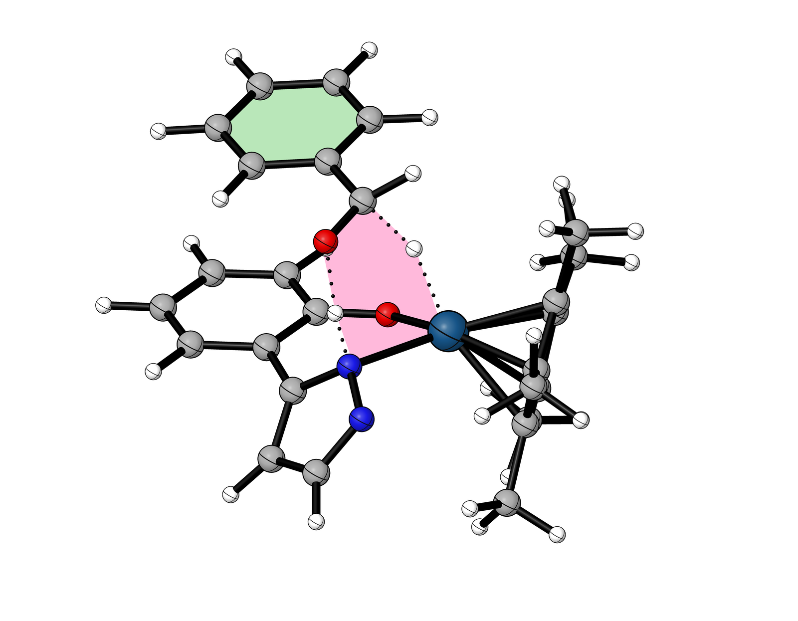
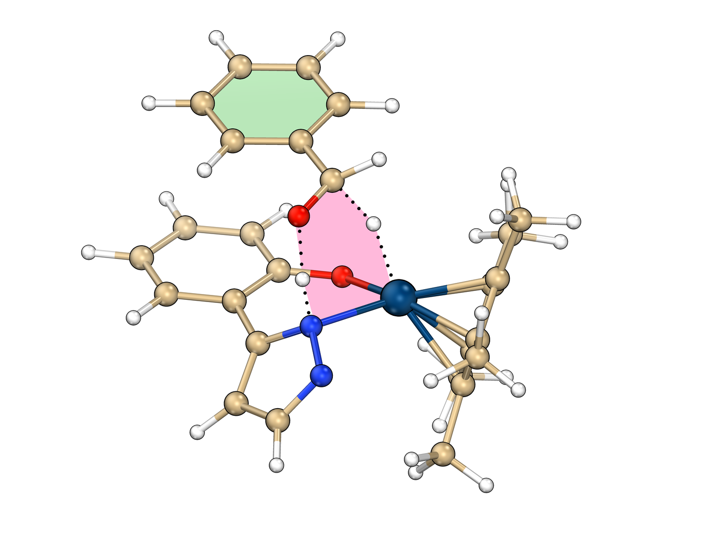
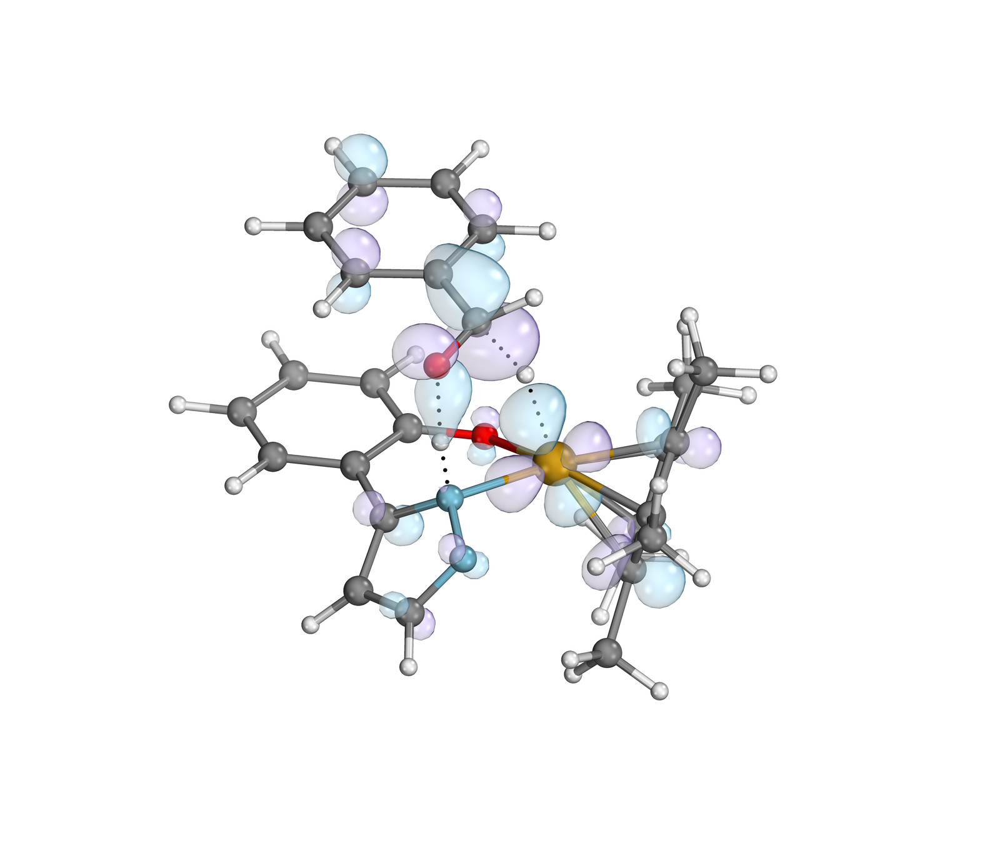
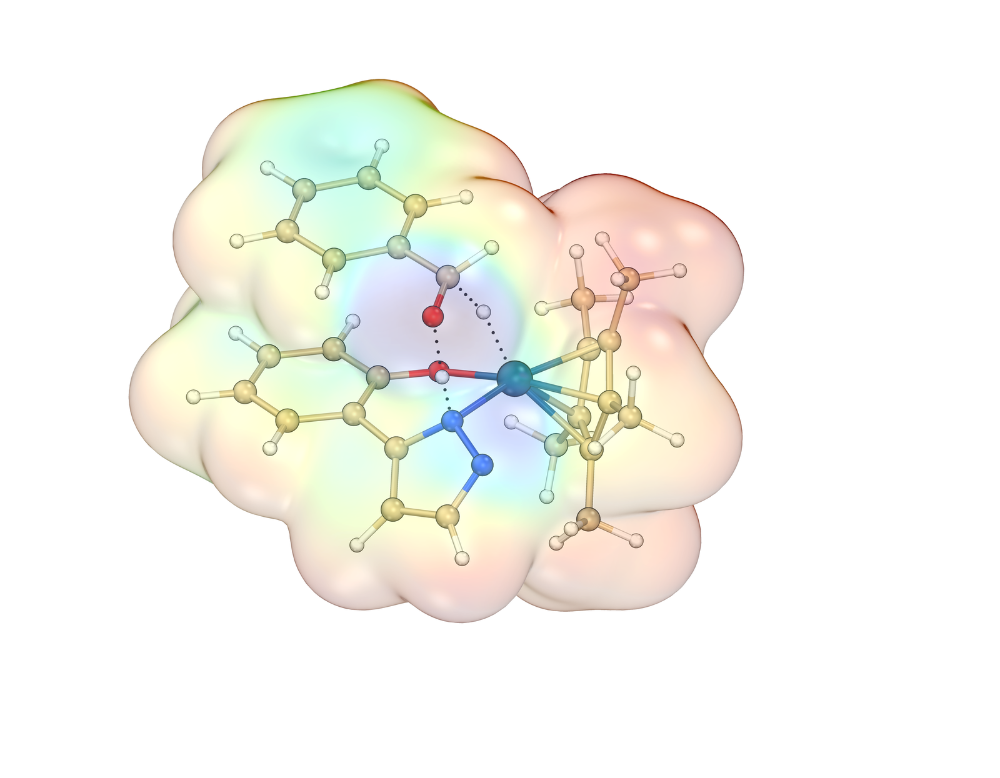
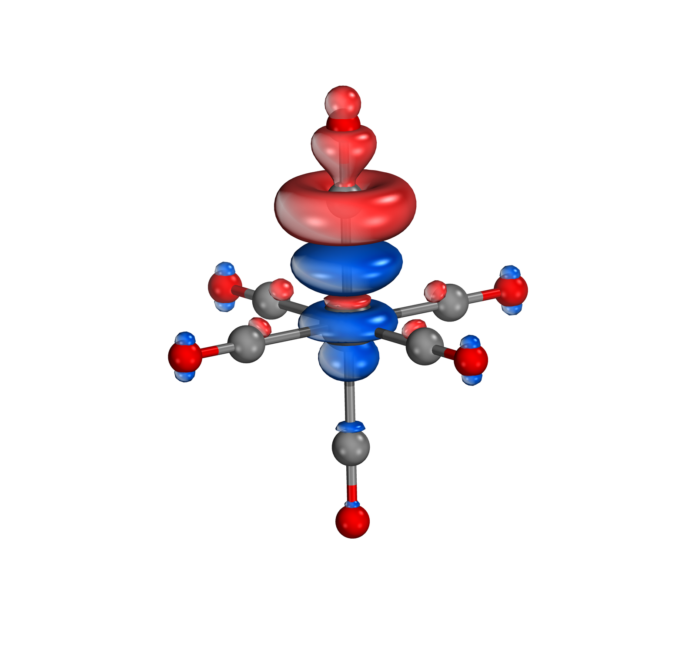
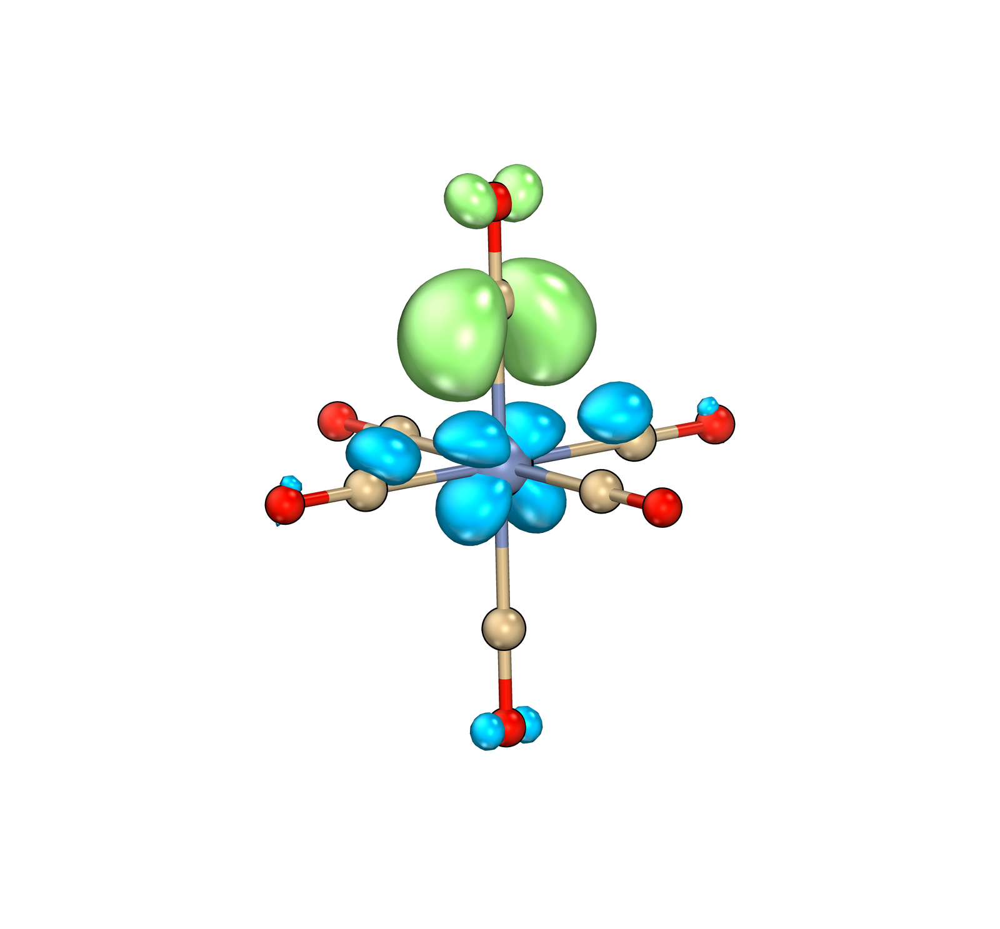
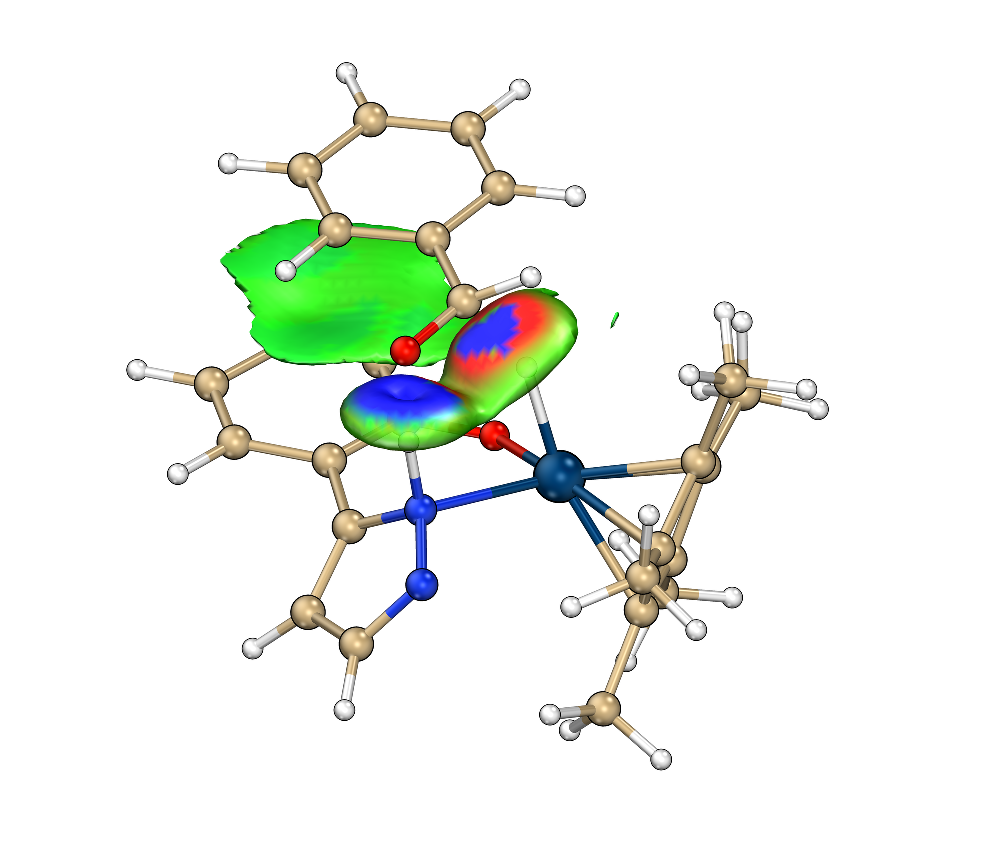
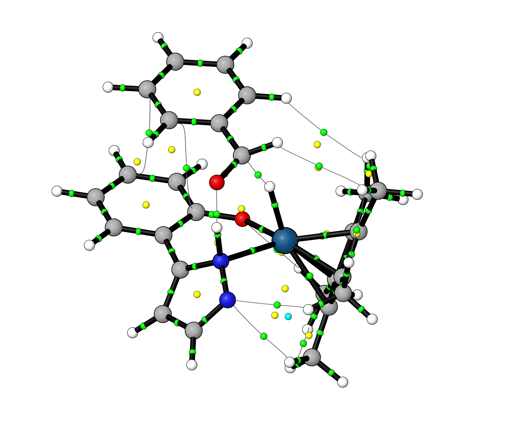
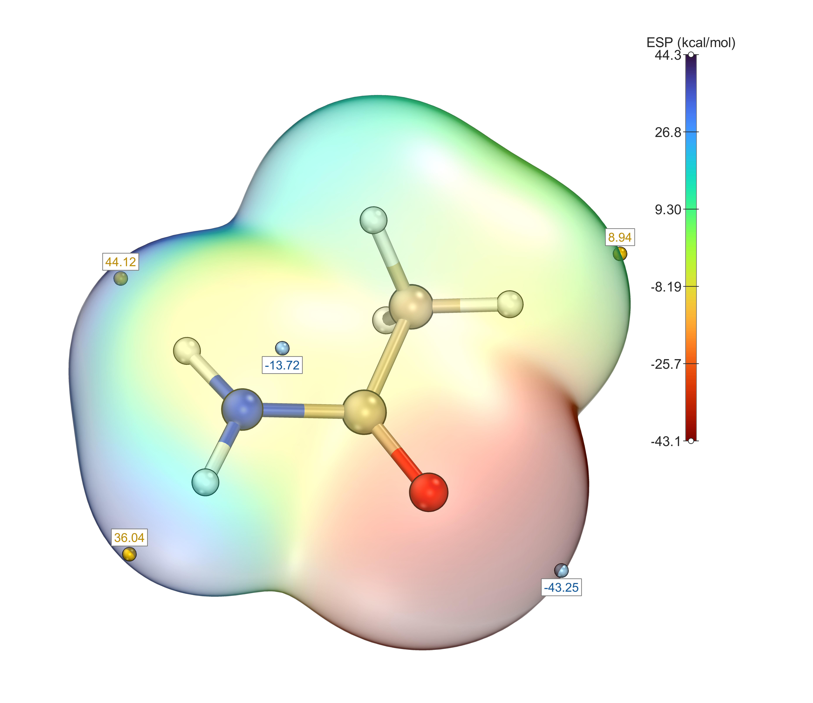

<h1 align="center">GXNU MolStudio</h1>

<p align="center">
  
  
  
  <a href="https://doi.org/10.5281/zenodo.22821586"></a>
  <a href="https://doi.org/10.26434/chemrxiv.15009253/v2"></a>
</p>

<p align="center">
  <a href="./README.md">English</a> · <strong>简体中文</strong>
</p>

<p align="center">
  <b>面向计算化学的可视化与工作流整合平台 — 从 fchk 到期刊精美轨道图，一站式完成。</b>
  <br>
  <sub>侯成课题组 · 广西师范大学</sub>
</p>

---

## 效果图展示（Gallery）

渲染效果图 —— 分子视图与波函数分析结果图。


<p align="center">
  
  
  
</p>
<p align="center">
  
  
  
</p>

<p align="center">
  <b>分析结果 — IGMH · AIM · ESP</b>
</p>
<p align="center">
  
  
  
</p>

---

## 简介

GXNU MolStudio 是一个面向计算化学的**可视化与工作流整合平台**：自带内嵌 OpenGL 3.3 实时渲染引擎，把原本分散在多个程序里的操作——生成 cube、实时预览、一键出图、批量处理——收进同一个图形界面。

需要说明它的定位——**软件本身不做波函数分析**。轨道、电荷布居、Mayer 键级、ESP 静电势、IGMH/IRI 弱相互作用、AIM 拓扑、分子平面性（MPP）、ETS-NOCV 等定量结果，全部由 [Multiwfn](http://sobereva.com/multiwfn/)（卢天老师开发）计算；MolStudio 负责驱动它、解析输出，并把结果变成可交互的等值面、曲线与图表。DI 能量分解、能量跨度（ESM）、IRC 拆分等模块，则是在读取 Gaussian / Multiwfn 输出之后由软件自行整理与作图。

当前版本「整合」的具体范围是：**读取** Gaussian / Multiwfn 的输入与输出（fchk、cube、wfn/wfx、log/out、chg、cif、xyz 等），**驱动** Multiwfn 生成 cube 并完成波函数分析，以及**完成**实时可视化、出图与批量处理。分子光谱页还可以从结构直接生成并本机运行 Gaussian 光谱任务，再自动调用 Multiwfn 出图。通用计算任务的远程排队、监控与集群调度仍不在本版范围内。

| 环节 | 由谁计算 | MolStudio 的角色 |
|---|---|---|
| 波函数分析：电荷 / Mayer 键级 / ESP / IGMH·IRI / AIM / MPP / ETS-NOCV | Multiwfn | 调用、解析、可视化 |
| 轨道 cube 生成 | Multiwfn | 触发、进度与日志、批处理 |
| UV-Vis / ECD / IR / Raman / VCD / ROA / 荧光 / 磷光 | Gaussian + Multiwfn | 结构导入、任务生成与本机运行、展宽、绘图 |
| 实时三维预览、一键出图 | 本软件（内嵌 OpenGL 引擎） | 全部 |
| 离线高分辨率渲染（兼容通道） | VMD + Tachyon | 风格编排与调用 |
| DI / ESM / IRC 等结果整理与作图 | 本软件 | 全部 |

> 因此，用 MolStudio 出图或得到定量结果时，请一并引用 Multiwfn 的原文；软件右侧「引文」页签会按你当前打开的功能列出应引文献。

| | 传统流程 | GXNU MolStudio |
|---|---|---|
| cube 生成 | 手动输入命令 | 双击轨道自动生成 |
| 3D 预览 | 手动 load、调等值面 | 内嵌 OpenGL 画布，滑块实时调整 |
| 渲染出图 | 手动调灯光、材质 | 一键样式，即时出图 |
| 弱相互作用 | 分开跑 IGMH/IRI 再拼图 | 面板内一键调用（Multiwfn）并可视化 |
| 批量处理 | 逐个文件重复操作 | 拖入文件夹，全自动批处理 |

---

## 功能特性

> 下列模块中的定量计算均由 **Multiwfn**（或读取 Gaussian 输出）完成，MolStudio 负责调用、解析结果并可视化。

### 🧬 内嵌 OpenGL 渲染引擎（ovcanvas）
- **顺序无关透明合成（深度剥离）** — 多层面内透明正确排序；不可用时自动回退排序混合
- **一键样式** — sob-art / IBOview / HoukMol / HoukMol3d / **2D 平涂** / IQmol / MolStudio / CYLview / VESTA，一键切换（2D 平涂 = HoukMol 配色 + 球体平涂，无渐变）
- **原子配色与光照正交双轴** — 原子配色（CPK / SobArt / HoukMol / Vcube …）× 光照（三光 / 单光 / 双光 / 四光）自由组合
- **每灯独立光晕** — 光源对话框支持方向/数量/光晕精细调节并保存载入
- **十字圆环** — HoukMol 风格球面大圆环，方位/俯仰可调、可锁定

### 🔬 分子显示辅助
- **隐藏氢原子** — 一键隐藏全部 H，突出重原子骨架
- **保留指定 H** — 输入编号（如 `1,3,5-8`），仅显示选中的 H
- **显示原子编号 / 元素符号** — 每个原子旁标注分子内序号或元素符号
- **中学分子结构库** — 内置 69 个初中、高中常用分子，可按分类、中文名、
  英文名、化学式和别名搜索；双击即可载入现有三维画布
- **PowerPoint 3D 模型** — 当前分子可导出为自包含 `.glb`，在 PowerPoint 365
  中通过“插入 → 3D 模型 → 此设备”加入；除分子外，还会把画布上当前显示的
  分子轨道、静电势及其他等值面一起写入，保留正负相位色、ESP 顶点色、
  透明度、原子配色、键样式、隐藏氢设置、球棍比例与当前视角。模型使用
  高细分顶点色网格、双面 PBR、黑色细描边和 KDTree 接触 AO；未手动指定时
  化学键统一按单键导出。静电势场景会另存同名 `_legend.png` 色标图

### 🧪 IGMH / IRI 弱相互作用分析
- **一键分析** — 选择片段，调用 Multiwfn 计算 IGMH 或 IRI 指标
- **BGR 着色** — sign(λ₂)ρ 蓝-绿-红着色，等值面大小/透明度滑块 + 精确输入框
- **IGM 散点图** — 内嵌散点图查看器

### ⚡ 量子化学数据分析
- **分子光谱一键工作流** — 导入 `.xyz` / `.gjf` / `.log` / `.fchk` 或使用当前画布结构，
  选择 UV-Vis、ECD、IR、Raman、VCD、ROA、荧光、磷光，一键完成 Gaussian 计算、
  Multiwfn 展宽和出图；UV-Vis/ECD 可自动先优化基态，振动谱自动生成对应的
  `freq` 路由，ROA 支持多入射波长。荧光自动完成 S1 几何优化并只保留 S1 发射；
  磷光自动优化 T1、建立稳定基态参考并计算三重态垂直发射能。已有 `.log/.out`
  也可直接复用，只重绘谱图。普通 Gaussian TDDFT 不含旋轨耦合，因此磷光峰位
  可用于分析，谱带强度明确标为归一化结果。
- **轨道浏览器** — 轨道能量、占据数、HOMO/LUMO 标注，双击自动生成 cube
- **ESP 静电势** — 等值面 + 极值点标注 + 色标条
- **NBO 分析** — 键级、占据、二阶微扰能（E2）轨道对
- **电荷分析** — Mulliken / 拟合电荷、键级可视化
- **IRC 分析** — 沿反应路径追踪 Mayer 键级与原子电荷变化，共享画布实时显示对应结构
- **Distortion–Interaction（DI）分析** — 左图右表布局：左侧整高显示原有
  “能量阶梯 + 分解柱状图”双图；绘图区下方左侧载入五个 Gaussian log，
  右侧集中显示计算按钮、能量/形变能/相互作用能结果表和导出操作
- **Energetic Span Model（ESM）** — 催化循环分析：识别 TDI/TDTS，计算能量跨度 δE 与 TOF，绘制台阶式能量剖面
- **AIM 拓扑** — 基于 `.wfn` / `.wfx` / fchk 输入的 QTAIM 键临界点（BCP）与键径分析
- **电荷与 Mayer 键级** — 电荷布居与 Mayer 键级组合面板
- **位阻地图 / 包埋体积（%VBur）** — 按 SambVca 官方流程（球心 / z 轴 / xz 平面
  原子 + 删除列表）定向配合物，一次算出整体/四象限/八分区 %VBur、buried / free
  体积，并绘制地形位阻地图（2D + 3D 地形）。地图形制对齐 StericRender：**固定
  ±R 色标** + sambvca 配色 + 黑色等高线 + 分子骨架 + 象限标签 + 轴指示 +
  横向色标，也可切换 SambVca 官方分阶风格（等高线间距 0.2 Å，与官方
  `plot_map.py` 一致）；色标、配色、骨架、等高线均可开关。「定向方式」**默认
  按左侧画布当前视角**（所见即所得：画布转到哪、地图就朝哪），也可切到
  SambVca 官方定向与文献 %VBur 对照，并用「同步画布朝向」把画布转到同一朝向；
  **画布点选**可把球心 / z 轴 / xz 平面原子和删除原子直接点出来——删除列表与
  画布多选实时同步，并有「用画布选中作删除列表 / 清空」按钮。结构可直接取
  画布或导入 `.xyz/.gjf/.log/.inp`，可导出 PNG/PDF/SVG、CSV、JSON 与官方
  SambVca `.inp`。引擎为 SambVca 2.1 官方 Fortran 算法的内置纯 numpy 复刻
  （官方 nhc 算例 %VBur 39.60，地形图与官方 `nhc-TopSurface.dat` 逐点一致），
  无需外部 SambVca 程序
- **xTB 半经验计算** — 直接调用外部 **xTB** 程序对画布结构（或导入
  `.xyz/.gjf/.com/.log/.out`）做 g-xTB / GFN2 / GFN1 / GFN0 / GFN-FF 计算：
  单点、几何优化、优化+频率与热化学、数值 Hessian、TS 优化、xcontrol 松弛扫描
  （带能量曲线）；支持电荷/未成对电子、SCF 精度、电子温度、ALPB/GBSA/COSMO
  隐式溶剂化、并行核数与额外命令行参数。结果显示总能量、HOMO–LUMO gap、
  HOMO/LUMO、偶极、梯度、原子电荷表、频率/虚频与 G/H/ZPE；优化或扫描末帧
  结构可**一键送回画布**，并可导出 XYZ/GJF/JSON/扫描轨迹。xTB 路径自动检测、
  设置自动保存；xTB 本体（LGPL-3.0）需自行安装，不随本软件分发

- **电子密度差（EDD）** — 以当前 fchk 为母体，在画布中框选/点选任意数量
  片段；母体和片段使用同一方法/基组、按母体原坐标并强制 `nosymm` 生成
  Gaussian 输入，可本地连续计算母体与全部片段并 formchk，也可手工载入多个
  状态/片段波函数。Multiwfn 执行
  `ρ(parent) − Σρ(fragment)` 并导出 cube，正、负密度区域在左侧画布中分别
  调色显示，支持等值面、透明度和 VMD 场景同步。

- **AICD 感应电流** — 读 Gaussian `nmr=csgt iop(10/93=1|2)` 的张量转储，
  直接出经典 AICD 效果图（黄色各向异性等值面 + 绿杆红尖头电流箭头 + 外磁场
  示意），支持轨道分解；「计算范围」下拉可一键切到**只看 π / 只看 σ**：
  自动用 Multiwfn 检测占据 π 轨道（共平面用平面法，配合物/扭曲体系用定域化 +
  π 型 LMO 投影 + 阈值），把输入改写成 `iop(10/93=2)` + 轨道号（轨道列表后
  留一个空行，否则 Gaussian 会漏读最后一个轨道），再本地/服务器计算并按范围
  出图。这一步**不要求先跑 AICD 全电子**：有同体系的 fchk/chk（opt/freq 等
  任何 SCF 留下的都行）就能自动检测；已知轨道号也可在「生成输入… → 指定轨道」
  里直接填。工作流简化为 5 个按钮：
  载入 GJF → 生成输入 → 本地运行 / 服务器运行 → 载入结果并出图。
  本地运行算完自动出图；服务器运行给出可复制的 `g16 < job.gjf > job.log`
  命令，算完把 `.log` 与同目录的张量 `.txt` 载入即可。结果可直接送进 OpenGL
  画布看三维等值面 + 箭头

### 🎬 传统 VMD / Tachyon 渲染（兼容模式）
- 30+ 精选渲染风格（vcube2.0、原创与自定义）
- 高分辨率输出（BMP/PNG，3000+）、可选透明背景、阴影/AO 控制
- 中英双语即时切换、运行日志、命令行批处理

---

## 快速开始

### 环境要求

| 组件 | 用途 | 安装 |
|------|------|------|
| Python 3.8+ | 运行环境 | [python.org](https://www.python.org/) |
| PyQt5 | GUI 界面 | `pip install PyQt5 PyOpenGL PyOpenGL-accelerate` |
| NumPy | 数值计算 | `pip install numpy` |
| PyMCubes | 等值面提取 | `pip install PyMCubes` |
| matplotlib | 散点图/色标 | `pip install matplotlib` |
| [Multiwfn](http://sobereva.com/multiwfn/) | fchk → cube、IGMH/IRI | 下载后配置路径 |
| [xTB](https://github.com/grimme-lab/xtb)（可选） | 半经验计算（SP/OPT/频率/扫描） | 下载后在「xTB 计算」页指定 `xtb.exe`（自动检测） |

> VMD / Tachyon 仅传统渲染模式需要；内嵌 OpenGL 画布不依赖它们。

### 安装

代码托管在 CNB —— **[cnb.cool/chem311/GXNU-MolStudio](https://cnb.cool/chem311/GXNU-MolStudio)**（预印本中给出的地址），GitHub 为镜像：[github.com/houcheng-gxnu/GXNU-MolStudio](https://github.com/houcheng-gxnu/GXNU-MolStudio)。

```bash
git clone https://cnb.cool/chem311/GXNU-MolStudio.git
# 镜像：git clone https://github.com/houcheng-gxnu/GXNU-MolStudio.git
cd GXNU-MolStudio
pip install -r requirements.txt      # 或：pip install -e . （以包方式安装）
```

### 配置工具路径

首次启动时在 GUI ⚙️ 设置中浏览选择 Multiwfn 等路径，自动保存到 `fchk_orbital.ini`。

### 启动

```bash
# GUI 模式（默认中文；内置英文界面）
python main.py
```

界面有四套可换的布局（功能完全一致，只是外观/布局不同）：

| `--ui` | 布局 | 源文件 |
|---|---|---|
| （默认）/ `classic` | 经典三栏 | `main_window.py` |
| `clean` | Clean Light 卡片 | `main_window_clean.py` |
| `clean2` | Bridge 卡片 | `main_window_clean2.py` |
| `canvas` | **画布优先**：58px 图标 rail、右侧抽屉可收起、一键样式收进下拉 | `main_window_canvas_first.py` |

```bash
python main.py --ui canvas            # 也可用环境变量：MOLSTUDIO_UI=canvas python main.py
python main_window_canvas_first.py    # 直接运行，效果相同
```

### 命令行模式（批处理）

```bash
# 单个文件，HOMO 轨道，sob-art 风格
python main.py input.fchk --mo h --iso 0.05 --style sob-art

# 批量处理文件夹，HOMO + LUMO
python main.py ./fchk_folder/ --mo h,l --iso 0.05

# 指定轨道、风格、高分辨率
python main.py input.fchk --mo h-1,h,l,l+1 --iso 0.04 --style lakers --res 3000,2250

# 仅生成 cube，不渲染（用于调试）
python main.py ./folder/ --mo h --grid 3 --no-render
```

| 参数 | 类型 | 默认值 | 说明 |
|------|------|--------|------|
| `input` | str | — | fchk 文件路径或文件夹路径 |
| `--mo` | str | `h` | 轨道选择：`h` (HOMO)、`l` (LUMO)、`h-1`、数字编号、逗号分隔 |
| `--iso` | float | `0.05` | 等值面阈值 |
| `--grid` | int | `2` | 网格质量：1=低, 2=中, 3=高 |
| `--style` | str | `sob-art` | 渲染风格 |
| `--res` | str | `2000,1500` | 输出分辨率 `宽,高`（也支持 `宽x高`） |
| `--no-render` | flag | — | 仅生成 cube，不渲染 |
| `--out` | str | 输入同目录 | 输出目录 |

---

### 自检

```bash
pip install pytest
pytest tests -q      # 全部子模块导入自检 + 界面离屏冒烟
```

---

## 项目结构

```
GXNU-MolStudio/
├── main.py                  # 薄入口 → molstudio.app:main
├── molstudio/               # 应用包
│   ├── app.py               # 启动流程（启动画面、界面选择、命令行批处理）
│   ├── paths.py             # 资源与配置路径解析（源码运行 / 打包运行）
│   ├── core/                # 后端引擎：fchk_orbital、fchk_parser、marching_cubes、
│   │                        #   workers、i18n、crystal_lib
│   ├── ui/                  # 窗口与外观：main_window（含 clean / clean2 /
│   │                        #   canvas-first）、dialogs、widgets、ui_icons、theme
│   ├── panels/              # 13 个分析面板 + etsnocv 子包
│   ├── render/              # ovcanvas 渲染引擎、molcanvas、vmd_embed、传统查看器
│   └── assets/              # 窗口图标、校徽、内置样式 json
├── tests/                   # 导入自检 + 界面离屏冒烟测试
├── screenshots/             # README 展示截图
├── legacy/                  # 已退役代码（保留参考，不参与打包）
├── OrbitalViewer.spec       # PyInstaller 打包配置（onedir）
├── pyproject.toml           # 项目元数据与依赖
└── requirements.txt         # 运行依赖
```

---

## 打包为独立 EXE

无需安装 Python 即可运行，适合分发给非技术用户：

```bash
pip install pyinstaller
pyinstaller OrbitalViewer.spec --clean
```

输出：`dist/MolStudio/`（文件夹形式 onedir，双击 `MolStudio.exe` 启动）。除启动器外
所有依赖都在同目录的 `_internal/` 子文件夹里，分发时请保持文件夹完整。

> 打包时已处理 360 安全卫士对个别系统 DLL 的写入拦截（见 spec 内注释）。

---

## 致谢

GXNU MolStudio 站在巨人的肩膀上：

- **[Multiwfn](http://sobereva.com/multiwfn/)** — 卢天老师开发的量子化学波函数分析程序，引用超 4 万篇论文。本项目使用其生成 cube、执行 IGMH/IRI 分析。
- **[vcube 2.0](http://bbs.keinsci.com/thread-18150-1-1.html)** — 钟成老师（武汉大学）提供的 VMD 批量渲染 cube 文件 Tcl 脚本，发布在计算化学公社论坛。
- **[VMD](https://www.ks.uiuc.edu/Research/vmd/)** — Humphrey, W., Dalke, A. and Schulten, K., "VMD: Visual Molecular Dynamics", J. Molec. Graphics, 1996, 14, 33–38.
- **[Tachyon](http://jedi.ks.uiuc.edu/~johns/raytracer/)** — Stone, J. E., "An Efficient Library for Parallel Ray Tracing and Animation", M.Sc. Thesis, 1998.
- **[IboView](https://www.iboview.org)** — Gerald Knizia 开发的量子化学可视化程序。其开源设计启发了本项目渲染器的部分思路，特此致谢。

---

## 引用

如果 GXNU MolStudio 对你的研究有帮助，请在论文中引用：

**软件文章（预印本）：**

Hou, C. GXNU MolStudio: An Integrated Open-Source Platform for Molecular Visualization and Quantum Chemical Analysis. *ChemRxiv* **2026**. DOI: [10.26434/chemrxiv.15009253/v2](https://doi.org/10.26434/chemrxiv.15009253/v2)（2026-09-28 发布，v2）。

```bibtex
@article{Hou2026GXNUMolStudio,
  author  = {Hou, Cheng},
  title   = {GXNU MolStudio: An Integrated Open-Source Platform for Molecular Visualization and Quantum Chemical Analysis},
  journal = {ChemRxiv},
  year    = {2026},
  doi     = {10.26434/chemrxiv.15009253/v2},
  url     = {https://doi.org/10.26434/chemrxiv.15009253/v2},
  note    = {Preprint, v2}
}
```

**软件存档（本次发布）：**

[](https://doi.org/10.5281/zenodo.22821586)

```bibtex
@software{GXNUMolStudio2026,
  title        = {GXNU MolStudio: Molecular Visualization and Quantum Chemical Analysis},
  author       = {Hou, Cheng},
  year         = {2026},
  version      = {1.0.0},
  doi          = {10.5281/zenodo.22821586},
  url          = {https://cnb.cool/chem311/GXNU-MolStudio},
}
```

`10.5281/zenodo.22821586` 是**版本 DOI**：永远指向 v1.0.0 这个快照，需要精确引用本次发布时用它。若要泛指这个软件本身，请用 [Zenodo 记录](https://doi.org/10.5281/zenodo.22821586) 页面上 "Cite all versions?" 给出的**概念 DOI**。

同时请引用上述致谢中的对应工具文献。另见 [CITATION.cff](./CITATION.cff) 和 [CITATION.bib](./CITATION.bib)。

软件里也做了对应整理：右侧设置区分成**「设置 / 引文」两个页签**，「引文」页签只列出左侧当前所选功能需要引用的文献——例如切到 IGMH 时会同时列出 Multiwfn 与 IGMH / IRI 原文，并逐条注明用在哪一步。点「复制全部引用」直接粘进稿件。对照表在 [`tab_references.py`](./tab_references.py)，文献编号与预印本长稿一致。

---

## 许可证

MolStudio 是自由软件，依 **GNU General Public License version 3（GPLv3）** 发布，
详见 [LICENSE](./LICENSE) 文件。

说明：

- **许可证版本** —— 部分随附第三方组件为 GPLv3-only，故本项目以 **GPLv3-only**（而非
  "GPLv3 或更高版本"）分发。各组件署名与许可细节见
  [THIRD-PARTY-NOTICES.md](./THIRD-PARTY-NOTICES.md)。
- **引用是请求，不是许可条件** —— 上文引用文献是学术层面的恳请，不构成附加许可条款
  （作为许可条件会因 GPLv3 §10 而无效）。

---

<p align="center">
  <sub>Made with ❤️ by Hou Cheng Research Group @ Guangxi Normal University</sub>
</p>
