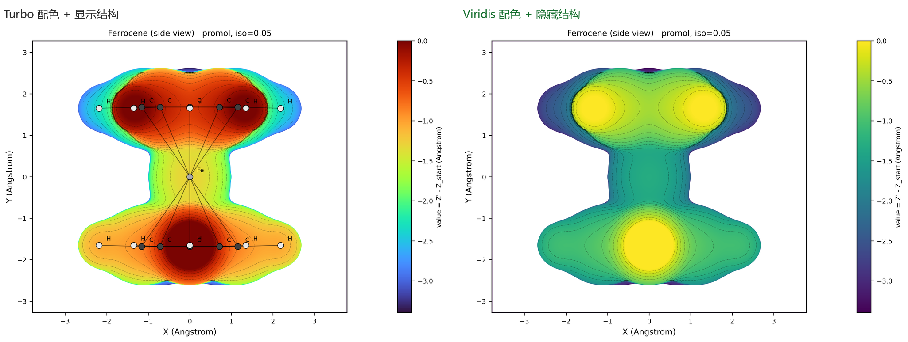

# AICD 与表面距离投影：本次更新包含两个功能

*Gaussian 与 Multiwfn 常用分析流程的界面集成*

文 / GXNU MolStudio　2026-10

AICD 感应电流图用于显示外磁场下的电流密度分布；表面距离投影图用于显示分子表面相对参考平面的深度。两类图的计算涉及 Gaussian、AICD/POV-Ray 或 Multiwfn 等多个步骤。

本次 GXNU MolStudio 更新包含两个功能：AICD 的五步流程与 π/σ 选择；表面距离投影的插值与显示选项。原理和参数说明见文末卢天老师（Sobereva）的三篇原文。

## 一、AICD：五步流程与 π/σ 选择

AICD 分析流程为五步：载入 GJF、生成输入、本地运行或服务器运行、载入结果并出图。本地运行完成后自动生成图像。服务器运行导出输入文件和 `g16 < job.gjf > job.log` 命令；计算完成后，载入 `.log` 与同目录的张量 `.txt`。

输入编辑器上方提供「计算范围」选项：全部电子、只看 π、只看 σ、输入中的轨道（`iop(10/93=2)`）。选择 π/σ 时，程序调用 Multiwfn 检测占据 π 轨道，改写输入并添加 `_pi` / `_sigma` 后缀；也可手动输入轨道编号（苯为 17、20、21）。该流程不要求先执行 AICD 全电子任务：存在同体系 fchk/chk 时可进行检测；已知轨道编号时，可不调用 Multiwfn。

π/σ 的默认参数为 iso 0.04、关闭场平滑；六视图按磁场方向旋转，B 箭头指向 +B。

全电子图的等值面包含 σ 局部环流，呈六角星形；π 图显示连续环电流。

## 二、表面距离投影：插值与显示选项

该功能对应 Multiwfn 主功能 300 → 8。在画布中调整分子朝向，点击「绘制投影图」；程序调用 Multiwfn、读取 `distmap.txt`，并叠加同朝向的原子。

本次更新包括：双三次插值；等值线在更高倍率网格上计算；修正等高线与结构错位/横竖颠倒；新增「显示分子结构」开关；配色增至 14 种（Jet、Turbo、Viridis、Plasma、Inferno、Magma、Cividis、Coolwarm 等）；保存默认 300 dpi。

切换配色、结构显示、留白或背景色时，程序重绘图像，不重新运行 Multiwfn。插值仅影响显示，`distmap.txt` 中的数值不变。

## 三、使用方法

**AICD：** 载入 gjf → 生成输入 → 本地/服务器运行 → 选择 π/σ → 载入结果出图。

**表面投影：** 调整画布朝向 → 打开「表面投影」页 → 设置表面/等值面/网格 → 绘制 → 设置配色/结构/留白 → 保存 300 dpi 图片。

## 四、通过智能体更新代码

项目代码托管于 CNB：https://cnb.cool/chem311/GXNU-MolStudio（仓库名 GXNU-MolStudio）。支持本机命令执行的智能体（如豆包）可用于代码同步：将仓库地址提供给智能体，执行 clone、按 `requirements.txt` 安装依赖、运行 `python main.py`；后续更新执行 `git pull`、安装新增依赖并重启程序。

也可在仓库目录手动执行 `git pull`。Git 为拉取式更新：代码推送至 CNB 后，其他副本需执行 pull 才会更新。智能体需具备本机命令执行权限和网络访问；Gaussian、Multiwfn、VMD 等本地程序需自行安装并配置路径，智能体仅负责代码同步和启动。

## 五、原理与参数说明

本文介绍更新功能与用法。AICD 理论、AICD 1.5/2.0 的安装与参数、Multiwfn 300 → 8 的扫描原理与设置，参见卢天老师（Sobereva）的原文：

[1] Sobereva（卢天）. 使用AICD程序研究电子离域性和磁感应电流密度. http://sobereva.com/147

[2] Sobereva（卢天）. 使用AICD 2.0绘制磁感应电流图. http://sobereva.com/294

[3] Sobereva（卢天）. 使用Multiwfn绘制分子和固体表面的距离投影图. http://sobereva.com/589

截图由 GXNU MolStudio 生成；二茂铁为 Multiwfn 自带示例结构。
