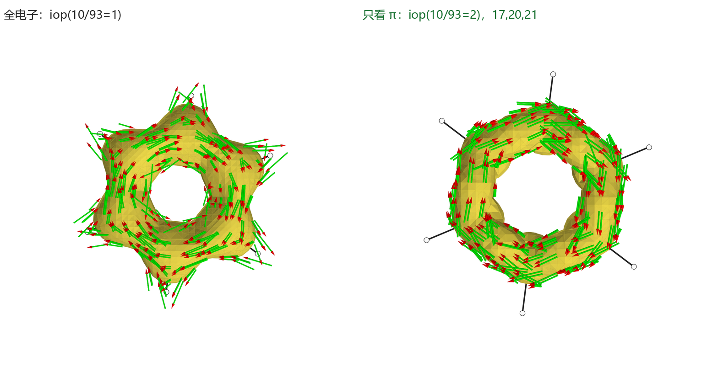

# AICD 与表面距离投影：这次更新了两个实用功能

*把 Gaussian + Multiwfn 的常用分析，收进一个看图工作流*

文 / GXNU MolStudio　2026-10

做芳香性或位阻分析时，有两类图很常用：AICD 感应电流图，用黄色等值面 + 箭头看外磁场下电子怎么走；表面距离投影图，用颜色看分子表面离参考平面有多深。

这两类图背后的计算都不复杂，麻烦的是流程：改 Gaussian 输入、等 NMR、装 AICD、跑 POV-Ray、调视角；或者打开 Multiwfn 300 → 8，设范围、等扫描、导数据、再画图。

这次 GXNU MolStudio 更新了两个功能：**AICD 的五个按钮流程 + 一键 π/σ**，以及**更好画、更好调的表面距离投影**。原理和参数细节不在这里展开，文末直接放卢天老师（Sobereva）的三篇原文，建议对照阅读。

## 一、AICD：五个按钮，一键切换 π / σ

AICD 分析被收成五步：**载入 GJF → 生成输入 → 本地运行 / 服务器运行 → 载入结果并出图**。本地算完自动出图；服务器模式会导出输入和一条可复制的 `g16 < job.gjf > job.log`，算完把 `.log` 和同目录的张量 `.txt` 拿回来即可。

输入编辑器上方新增「计算范围」：全部电子、只看 π、只看 σ、输入里的轨道（`iop(10/93=2)`）。选 π/σ 时，程序用 Multiwfn 自动检测占据 π 轨道，改写输入并加 `_pi` / `_sigma` 后缀；也可以直接手填轨道号（苯是 17、20、21）。**不需要先跑一遍 AICD 全电子任务**：有同体系 fchk/chk 就能检测，知道编号则连 Multiwfn 都不用跑。

π/σ 图默认 iso 0.04、关闭场平滑，让 π 环更容易连成完整的一圈；六视图会按磁场方向旋转，B 箭头指向 +B。

全电子图里 σ 的局部环流让等值面呈六角星形；只看 π 时是一圈连续的环电流。做芳香性讨论时，π 图通常更干净。

## 二、表面距离投影：更光滑、更好调

这个功能对应 Multiwfn 的主功能 300 → 8：你在画布上把分子转到想要的朝向，点「绘制投影图」，程序跑 Multiwfn、读 `distmap.txt`，再把同一朝向的原子叠上去。

这次主要改善出图：双三次插值、等值线在高一档网格上计算，轮廓和色带不再沿原始格子走台阶；修正了等高线与结构错位/横竖颠倒的问题；新增「显示分子结构」开关，关掉只留色带和等高线；配色增加到 14 种（Jet、Turbo、Viridis、Plasma、Inferno、Magma、Cividis、Coolwarm 等）；保存默认 300 dpi。

切换配色、显示结构、留白和背景色会立即重画，不会重算 Multiwfn；插值只影响显示，`distmap.txt` 里的数值不变。

## 三、怎么用

**AICD：** 载入 gjf → 生成输入 → 本地/服务器运行 → 选 π/σ → 载入结果出图。

**表面投影：** 画布转到合适朝向 → 打开「表面投影」页 → 设表面/等值面/网格 → 绘制 → 调配色/结构/留白 → 保存 300 dpi 图片。

## 四、也可以让智能体帮你更新

项目代码托管在 CNB：https://cnb.cool/chem311/GXNU-MolStudio（仓库名 GXNU-MolStudio）。如果你在用豆包等支持在本机执行命令/调用工具的智能体，可以把仓库地址直接给它，让它 clone、按 `requirements.txt` 装依赖、`python main.py` 启动；以后每次说「把 GXNU MolStudio 更新到最新」，它执行 `git pull`、补装新增依赖、重启程序。

手动更新也很简单：在仓库目录执行 `git pull`。注意 Git 是拉取式更新，push 到 CNB 后，别人/智能体要 pull 才生效，不是自动推送到每台机器；前提是智能体能在这台机器上执行命令并联网。Gaussian、Multiwfn、VMD 等本地程序仍需自己装好，并在程序的路径设置里配好——智能体负责代码同步和启动，不替代这些计算软件。

## 五、原理与细节请看卢天老师原文

本文只介绍这次更新的功能和用法；AICD 的理论、AICD 1.5/2.0 的安装与参数、Multiwfn 300→8 的扫描原理和设置，请直接读卢天老师（Sobereva）的三篇原文：

[1] Sobereva（卢天）. 使用AICD程序研究电子离域性和磁感应电流密度. http://sobereva.com/147

[2] Sobereva（卢天）. 使用AICD 2.0绘制磁感应电流图. http://sobereva.com/294

[3] Sobereva（卢天）. 使用Multiwfn绘制分子和固体表面的距离投影图. http://sobereva.com/589

文中截图由 GXNU MolStudio 生成；二茂铁为 Multiwfn 自带示例结构，仅作演示。
